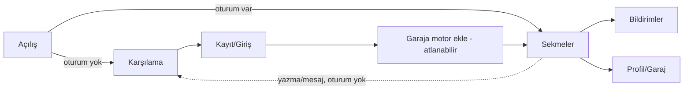

# Gezinme yapısı ve ekran listesi (v0.1)

## Karar
Yedi alan + ortak parçalar 5 alt sekmeye sığdırıldı (mobilde en fazla 5). Üst çubukta bildirim zili ve profil avatarı.

| Sekme | İçerik | Rota (öneri) |
| --- | --- | --- |
| Topluluk | Üstte segment: **Konular** (bilgi/forum) · **Sorunlar** (sorun çözümü) · **Not duvarı** | `(tabs)/topluluk` |
| İkinci el | İlan listesi + filtre | `(tabs)/ikinci-el` |
| Rotalar | Rota listesi / harita | `(tabs)/rotalar` |
| Etkinlik | Buluşma ve etkinlikler | `(tabs)/etkinlik` |
| Sohbet | Odalar + birebir mesajlar | `(tabs)/sohbet` |

Bildirimler `/bildirimler`, profil `/profil`. Oluştur (+) her sekmede sağ üstte.
Oturumsuz kullanıcı gezebilir; yazma/mesaj/ilan eyleminde giriş ister, girişten sonra kaldığı yere döner.

## Ekranlar
**Ortak:** Karşılama · Kayıt · Giriş · Şifre sıfırlama · Profil (kendi/başkası) · Profil düzenle · Garaj (motor ekle/düzenle) · Rozet ve puan · Bildirimler · Ayarlar (tema, bildirim, konum izni, engellenenler, hesabı sil) · Şikâyet formu (alt sayfa) · Engellenenler.
**Bilgi ve forum:** Konu listesi (filtre: Benim motorum, etiket, şehir) · Konu detayı + yorumlar · Konu oluştur.
**Sorun çözümü:** Sorun listesi (Açık/Çözüldü) · Sorun detayı (foto/video, "çözüm" işaretle) · Sorun sor · Model bilgi bankası.
**İkinci el:** İlan listesi (motor/parça/ekipman) · İlan detayı (satıcı puanı, dolandırıcılık uyarısı, ruhsat/şasi hatırlatması) · İlan ver · İlanlarım · İlan mesajlaşması.
**Rotalar:** Rota listesi · Harita (MapLibre) · Rota detayı (viraj/manzara/mola, foto, yol durumu) · Rota ekle (çiz/GPX).
**Buluşma ve etkinlik:** Etkinlik listesi (yakın/tarih) · Etkinlik detayı (katılım listesi, toplanma noktası haritada) · Etkinlik oluştur · Etkinlik sohbeti.
**Not duvarı:** Anonim not akışı · Not yaz (hedefleme yasağı hatırlatması) · Tepki. Reklam yok.
**Canlı sohbet:** Oda listesi (şehre göre önerilen) · Oda sohbeti · Birebir mesaj listesi · Birebir sohbet.

## Her liste ekranında zorunlu durumlar
Yükleniyor (iskelet) · Boş (EmptyState + eylem) · Hata (+ tekrar dene) · Çevrimdışı (son veri + uyarı şeridi).

## Akış

